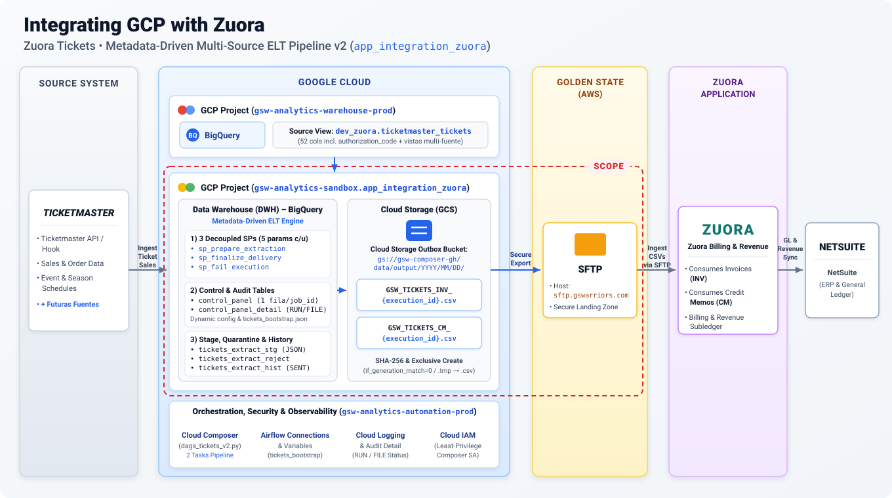

# 📘 Guía de Despliegue y Operación Multi-Fuente (`dags_tickets_v2`)


Esta guía detalla el paso a paso para desplegar, ejecutar, monitorear y escalar la solución en el dataset **`gsw-analytics-sandbox.app_integration_zuora`** y en **Cloud Composer**.



> [!TIP]
> Todos los archivos de la carpeta [`setup/`](./setup/) están numerados (`01_` al `04_`) en el orden exacto en que deben ejecutarse en BigQuery.

---

## 🧭 Índice de Implementación

1. [🗄️ Paso 1: Ejecutar los scripts SQL en BigQuery](#️-paso-1-ejecutar-los-scripts-sql-en-bigquery)
2. [🔍 Paso 2: Validar la configuración en `control_panel`](#-paso-2-validar-la-configuración-en-control_panel)
3. [🌬️ Paso 3: Configurar Variable y subir el DAG en Cloud Composer](#️-paso-3-configurar-variable-y-subir-el-dag-en-cloud-composer)
4. [▶️ Paso 4: Activar y disparar el DAG `dags_tickets_v2`](#️-paso-4-activar-y-disparar-el-dag-dags_tickets_v2)
5. [📊 Paso 5: Monitoreo y verificación post-ejecución](#-paso-5-monitoreo-y-verificación-post-ejecución)
6. [🛠️ Paso 6: Recuperación ante fallos y desbloqueo de cola](#️-paso-6-recuperación-ante-fallos-y-desbloqueo-de-cola)
7. [➕ Paso 7: Cómo agregar una nueva vista fuente](#-paso-7-cómo-agregar-una-nueva-vista-fuente)
8. [🔄 Paso 8: Cómo cambiar la ruta de GCS o activar entrega por SFTP](#-paso-8-cómo-cambiar-la-ruta-de-gcs-o-activar-entrega-por-sftp)

---

## 🗄️ Paso 1: Ejecutar los scripts SQL en BigQuery

En la consola de BigQuery (proyecto `gsw-analytics-sandbox`, ubicación `US`), copia y ejecuta el contenido completo de cada archivo en este orden:

### 1.1 [`setup/01_setup_control_tables.sql`](./setup/01_setup_control_tables.sql)
- Crea automáticamente el dataset `gsw-analytics-sandbox.app_integration_zuora` en `US`.
- Crea las 4 tablas operativas:
  - `control_panel` (catálogo de fuentes configuradas).
  - `control_panel_detail` (bitácora de ejecuciones `RUN` y manifiestos `FILE`).
  - `tickets_extract_stg` (stage multi-fuente en JSON particionado por `capture_date`).
  - `tickets_extract_reject` (cuarentena de calidad por lote completo).

### 1.2 [`setup/02_seed_control_panel.sql`](./setup/02_seed_control_panel.sql)
- Ejecuta un `MERGE` idempotente que registra la fuente `zuora_tickets` (`config_version = 1`, `enabled = TRUE`) leyendo de `gsw-analytics-warehouse-prod.dev_zuora.ticketmaster_tickets` y apuntando a `gsw-analytics-sandbox.app_integration_zuora.tickets_extract_hist`.
- Registra las **52 columnas** en `schema_source`, incluyendo `authorization_code` en la posición 52.

> [!NOTE]
> Si la vista `ticketmaster_tickets` aún no expone físicamente la columna `authorization_code`, el script la registra con `required = FALSE` para que se exporte como `NULL` en el histórico y en el `.csv` sin detener la operación. En cuanto la vista exponga la columna, tomará su valor automáticamente.

### 1.3 [`setup/03_create_tickets_extract.sql`](./setup/03_create_tickets_extract.sql)
- Crea la tabla histórica destino `gsw-analytics-sandbox.app_integration_zuora.tickets_extract_hist` con las 52 columnas en minúsculas más los 10 campos de auditoría y trazabilidad (`run_id`, `line_status`, `sent_run_id`, `sent_at`, `job_id`, `execution_id`, `file_type`, `file_name`, `destination_uri`, `checksum`).

### 1.4 [`setup/04_deploy_zuora_procedure.sql`](./setup/04_deploy_zuora_procedure.sql)
- Despliega los **3 procedimientos almacenados desacoplados** (5 parámetros cada uno):
  1. **`sp_prepare_extraction(p_job_id, p_execution_id, p_dag_id, p_airflow_run_id, p_logical_date)`**
  2. **`sp_finalize_delivery(p_job_id, p_execution_id, p_file_type, p_checksum, p_row_count)`**
  3. **`sp_fail_execution(p_job_id, p_execution_id, p_file_type, p_error_step, p_error_message)`**

---

## 🔍 Paso 2: Validar la configuración en `control_panel`

Ejecuta la siguiente consulta en BigQuery para verificar el registro de la fuente:

```sql
SELECT job_id, config_version, enabled,
       source_project, source_dataset, source_object,
       target_table, dedup_keys, file_types,
       destination_type, destination_config, sample_rows_per_type,
       ARRAY_LENGTH(JSON_QUERY_ARRAY(schema_source)) AS total_columns
FROM `gsw-analytics-sandbox.app_integration_zuora.control_panel`
ORDER BY job_id, config_version;
```

- **Resultado esperado**: `job_id = 'zuora_tickets'`, `enabled = TRUE`, `target_table = 'gsw-analytics-sandbox.app_integration_zuora.tickets_extract_hist'` y `total_columns = 52`.

---

## 🌬️ Paso 3: Configurar Variable y subir el DAG en Cloud Composer

Entorno Composer: proyecto `gsw-analytics-automation-prod`, entorno `gsw-composer-gh` (`us-central1`).

1. **Crear/Actualizar la Variable en Airflow UI**:
   - Ir a **Admin → Variables** y configurar la clave **`tickets_bootstrap`** con el contenido de [`setup/tickets_bootstrap.json`](./setup/tickets_bootstrap.json):
     ```json
     {
       "project": "gsw-analytics-sandbox",
       "dataset": "app_integration_zuora",
       "table": "control_panel",
       "location": "US",
       "connection_id": "google_cloud_default"
     }
     ```
2. **Subir el DAG al bucket de Composer**:
   - Subir a `gs://gsw-composer-gh/dags/` únicamente el archivo:
     - [`airflow/dags_tickets_v2.py`](./airflow/dags_tickets_v2.py)

> [!TIP]
> `dags_tickets_v2.py` es **100% autocontenido**: construye las llamadas parametrizadas a los 3 Stored Procedures directamente en Python y no necesita archivos `.sql` auxiliares en la carpeta `dags/`.

---

## ▶️ Paso 4: Activar y disparar el DAG `dags_tickets_v2`

En **Airflow UI**, activa el DAG **`dags_tickets_v2`** (`prepare_batches >> publish_files`) y ejecútalo:

| Modo de Ejecución | Valor en el campo `job_id` (Formulario Airflow UI) | Equivalente JSON (`Trigger DAG w/ config`) |
|---|---|---|
| **Ejecutar una fuente específica** *(Por defecto)* | `zuora_tickets` | `{"job_id": "zuora_tickets"}` |
| **Ejecutar todas las fuentes con `enabled = TRUE`** | `ALL` | `{"job_id": "ALL"}` |
| **Ejecutar una lista de fuentes** | — *(Usar JSON)* | `{"job_ids": ["zuora_tickets", "otra_fuente"]}` |

---

## 📊 Paso 5: Monitoreo y verificación post-ejecución

### 5.1 Bitácora de Ejecuciones y Archivos (`control_panel_detail`)
```sql
SELECT job_id, execution_id, record_type, file_type, status,
       source_rows, rows_extracted, rows_held, rows_exported,
       file_name, destination_uri, checksum,
       error_step, error_message, started_at, finished_at
FROM `gsw-analytics-sandbox.app_integration_zuora.control_panel_detail`
ORDER BY started_at DESC, job_id, record_type DESC;
```

### 5.2 Registros Confirmados en Histórico (`tickets_extract_hist`)
```sql
SELECT job_id, execution_id, file_type, line_status, file_name,
       destination_uri, COUNT(*) AS rows_sent
FROM `gsw-analytics-sandbox.app_integration_zuora.tickets_extract_hist`
GROUP BY 1, 2, 3, 4, 5, 6
ORDER BY execution_id DESC, file_type;
```

### 5.3 Conteo por Estado en Stage del Día (`tickets_extract_stg`)
```sql
SELECT job_id, execution_id, line_status, COUNT(*) AS total_rows
FROM `gsw-analytics-sandbox.app_integration_zuora.tickets_extract_stg`
WHERE capture_date = CURRENT_DATE('UTC')
GROUP BY 1, 2, 3
ORDER BY execution_id DESC, line_status;
```

---

## 🛠️ Paso 6: Recuperación ante fallos y desbloqueo de cola

- **🟡 Tarea en `up_for_retry` (cuadro amarillo) bloqueando otros runs**:
  - Selecciónala en la vista **Grid** de Airflow UI y pulsa **Mark state as... → Failed** para cerrar ese intento inmediatamente.
- **🔴 Fallo de red durante la subida de archivos (`publish_files`)**:
  - Haz **Clear task** únicamente sobre la tarea `publish_files` del **mismo DAG Run**.
  - El proceso omitirá los archivos que ya estén `SENT`, validará por `sha256`/tamaño cualquier archivo que ya se haya subido a GCS o SFTP antes del corte y confirmará la transacción pendiente en `tickets_extract_hist`.

---

## ➕ Paso 7: Cómo agregar una nueva vista fuente

Para incorporar una nueva vista al flujo sin modificar [`airflow/dags_tickets_v2.py`](./airflow/dags_tickets_v2.py) ni [`setup/04_deploy_zuora_procedure.sql`](./setup/04_deploy_zuora_procedure.sql):

1. **Crear su tabla histórica destino (`target_table`)** en `gsw-analytics-sandbox.app_integration_zuora` con las columnas de la vista en minúsculas más las 10 columnas operativas (`run_id`, `line_status`, `sent_run_id`, `sent_at`, `job_id`, `execution_id`, `file_type`, `file_name`, `destination_uri`, `checksum`), tomando como plantilla [`setup/03_create_tickets_extract.sql`](./setup/03_create_tickets_extract.sql).
2. **Insertar su fila de configuración en `control_panel`** con un nuevo `job_id`, `enabled = TRUE`, `source_object`, `target_table`, `schema_source`, `dedup_keys`, `file_types` y `destination_config`, tomando como plantilla [`setup/02_seed_control_panel.sql`](./setup/02_seed_control_panel.sql).

---

## 🔄 Paso 8: Cómo cambiar la ruta de GCS o activar entrega por SFTP

Toda la ruta y protocolo de entrega se controlan desde `control_panel` mediante un simple `UPDATE` en BigQuery:

### ☁️ A. Cambiar bucket, carpeta (`prefix`) o plantilla en Cloud Storage (`GCS`)
```sql
UPDATE `gsw-analytics-sandbox.app_integration_zuora.control_panel`
SET destination_type = 'GCS',
    destination_config = JSON '{"bucket":"gsw-composer-gh","prefix":"data/output","date_path_format":"%Y/%m/%d","file_name_template":"GSW_TICKETS_{file_type}_{execution_id}.csv"}',
    updated_at = CURRENT_TIMESTAMP()
WHERE job_id = 'zuora_tickets' AND enabled;
```

### 🔒 B. Cambiar el destino de entrega a un servidor `SFTP`
1. Crear la conexión en **Airflow UI → Admin → Connections** (p. ej. `Conn Id = zuora_sftp`, `Conn Type = SFTP / SSH`).
2. Ejecutar en BigQuery:
```sql
UPDATE `gsw-analytics-sandbox.app_integration_zuora.control_panel`
SET destination_type = 'SFTP',
    destination_config = JSON '{"sftp_connection_id":"zuora_sftp","remote_path":"/data/input","date_path_format":"","file_name_format":"GSW_TICKETS_{file_type}_{execution_id}.csv","file_name_template":"GSW_TICKETS_{file_type}_{execution_id}.csv"}',
    updated_at = CURRENT_TIMESTAMP()
WHERE job_id = 'zuora_tickets' AND enabled;
```
> [!NOTE]
> Si deseas subcarpetas por fecha en el SFTP, configura `"date_path_format": "%Y/%m/%d"`; si prefieres que los archivos `.csv` se depositen directamente en `/data/input/`, déjalo vacío `""`.
