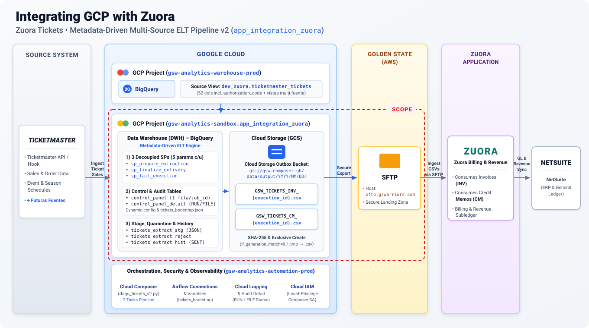
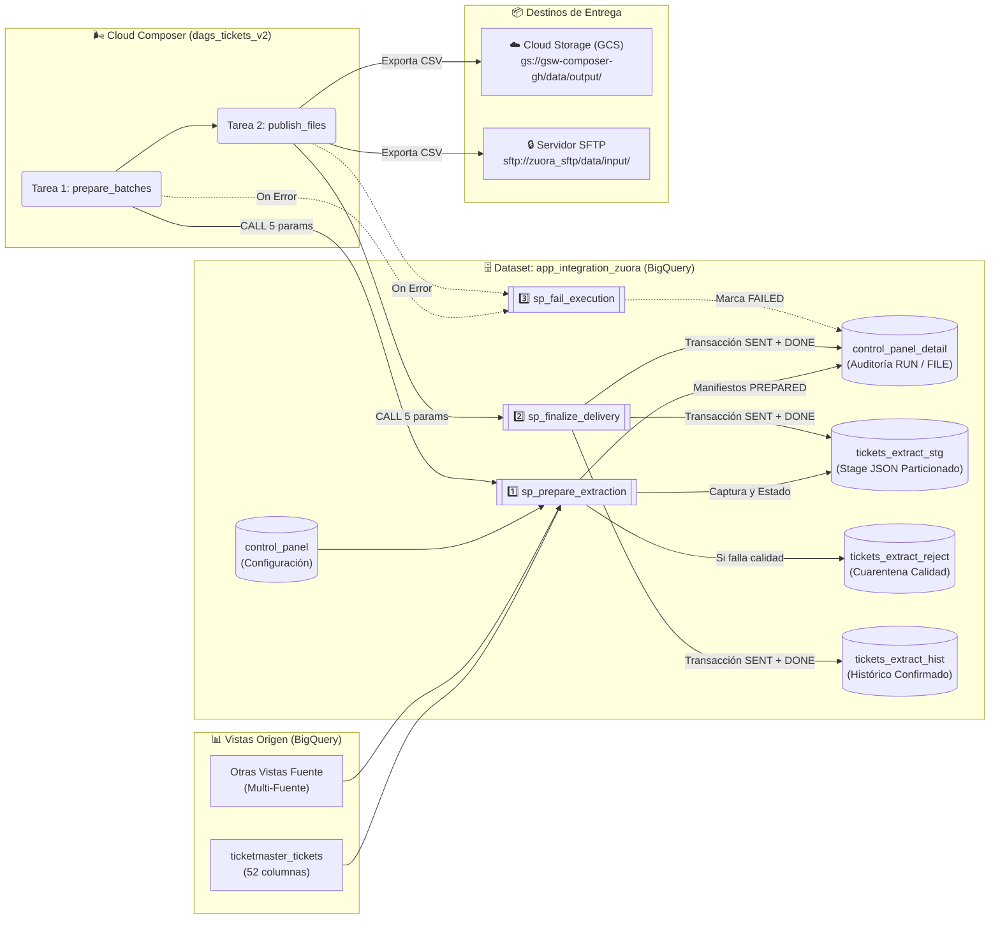

# 🚀 GSW Airflow BigQuery to Cloud Storage / SFTP (`dags_tickets_v2`)


Pipeline corporativo **Multi-Fuente y Multi-Destino (`GCS` / `SFTP`)** gobernado 100% por tablas de control en **Google BigQuery** (`gsw-analytics-sandbox.app_integration_zuora`) y orquestado mediante un adaptador ligero en **Cloud Composer (Airflow 2)**.

> [!IMPORTANT]
> **Principio de diseño:** Las vistas origen nunca se modifican y Python no ejecuta reglas de negocio ni transformaciones de datos. Toda la validación de esquema, captura en stage, control de calidad, deduplicación e historial ocurre dentro de BigQuery a través de **3 procedimientos almacenados desacoplados**.

---

## 📑 Tabla de Contenidos

- [🏛️ Arquitectura de Datos End-to-End (GCP → Zuora)](#️-arquitectura-de-datos-end-to-end-gcp--zuora)
- [🏗️ Flujo Técnico de Orquestación y Stored Procedures](#️-flujo-técnico-de-orquestación-y-stored-procedures)
- [📂 Estructura del Repositorio](#-estructura-del-repositorio)
- [🧩 Componentes en BigQuery](#-componentes-en-bigquery)
- [⚙️ Guía Rápida de Despliegue](#️-guía-rápida-de-despliegue)
- [🧪 Ejecución de Pruebas](#-ejecución-de-pruebas)
- [🐙 Guía para Subir y Versionar en GitHub](#-guía-para-subir-y-versionar-en-github)

---

## 🏛️ Arquitectura de Datos End-to-End (GCP → Zuora)



### Capas de la Arquitectura Corporativa

| Capa / Dominio | Sistema / Proyecto | Objetos Principales | Rol en la Arquitectura |
|---|---|---|---|
| **1. Source System** | **Ticketmaster** *(+ futuras fuentes)* | Ticketmaster API / Hook, Sales & Order Data, Event & Season Schedules | Sistema transaccional origen que genera las ventas de boletos, órdenes y calendarios de temporada. |
| **2. Google Cloud (Origen)** | `gsw-analytics-warehouse-prod` | Vista BigQuery: `dev_zuora.ticketmaster_tickets` *(52 columnas incl. `authorization_code`)* | Capa semántica de lectura inmutable que expone los registros listos para extracción. |
| **3. Google Cloud (Motor ELT – SCOPE)** | `gsw-analytics-sandbox`<br>Dataset: `app_integration_zuora` | **SPs**: `sp_prepare_extraction`, `sp_finalize_delivery`, `sp_fail_execution`<br>**Tablas**: `control_panel`, `control_panel_detail`, `tickets_extract_stg`, `tickets_extract_reject`, `tickets_extract_hist` | Motor ELT guiado por metadatos: valida esquema/calidad, aplica retenciones por temporada (`HOLD`), deduplica contra histórico y genera los lotes. |
| **4. Google Cloud (Outbox – SCOPE)** | Cloud Storage (`gsw-composer-gh`) | `gs://gsw-composer-gh/data/output/YYYY/MM/DD/`<br>`GSW_TICKETS_INV_{execution_id}.csv`<br>`GSW_TICKETS_CM_{execution_id}.csv` | Zona de publicación de archivos CSV con verificación `SHA-256` y creación exclusiva (`if_generation_match=0`). |
| **5. Orquestación y Seguridad** | `gsw-analytics-automation-prod` | Cloud Composer (`dags_tickets_v2.py`), Airflow Variables (`tickets_bootstrap`), Cloud Logging, Cloud IAM | Orquestación en 2 tareas (`prepare_batches >> publish_files`), gestión de credenciales y observabilidad. |
| **6. Golden State AWS (SCOPE)** | **SFTP Landing Zone** | `sftp.gswarriors.com` (`/data/input`) | Zona de aterrizaje segura con escritura atómica (`.tmp` → `.csv`) para ingesta hacia Zuora. |
| **7. Zuora & NetSuite (Downstream)** | **Zuora Billing & Revenue** → **NetSuite ERP** | Invoices (`INV`), Credit Memos (`CM`), Revenue Subledger & General Ledger | Consumo de facturas/notas de crédito en Zuora y sincronización contable hacia NetSuite. |

---

## 🏗️ Flujo Técnico de Orquestación y Stored Procedures

El flujo en Airflow se compone únicamente de **2 tareas (`prepare_batches >> publish_files`)** que invocan **3 procedimientos almacenados de responsabilidad única** (5 parámetros cada uno):



---

## 📂 Estructura del Repositorio

```text
gsw_airflow_bq_to_cs/
├── 📂 airflow/
│   └── 🐍 dags_tickets_v2.py             # DAG autocontenido (prepare_batches >> publish_files)
├── 📂 assets/
│   └── 🖼️ architecture_gcp_zuora.svg     # Diagrama oficial de Arquitectura de Datos End-to-End (SVG)
├── 📂 setup/
│   ├── 📜 01_setup_control_tables.sql    # DDL: schema app_integration_zuora + 4 tablas de control/stage
│   ├── 📜 02_seed_control_panel.sql      # MERGE idempotente del contrato zuora_tickets (52 columnas)
│   ├── 📜 03_create_tickets_extract.sql  # DDL: tabla histórica tickets_extract_hist
│   ├── 📜 04_deploy_zuora_procedure.sql  # 3 Stored Procedures desacoplados (5 parámetros c/u)
│   └── ⚙️ tickets_bootstrap.json         # Payload para la Airflow Variable tickets_bootstrap
├── 📂 test/
│   ├── 🧪 test_offline.py                # 23 pruebas unitarias locales (sin conexión a GCP)
│   ├── ☁️ run_cloud_tests.py             # Runner de integración sobre dataset aislado *_test
│   ├── 📜 cloud_fixtures.sql             # Fixtures sintéticos para 12 escenarios de prueba
│   ├── 📜 cloud_checks.sql               # Aserciones de auditoría, stage, reject e histórico
│   ├── 📜 cloud_change_source.sql        # Simulación de cambio en vista para snapshot_recovery
│   ├── 📦 requirements.txt               # Dependencias para pruebas cloud
│   └── 📖 README.md                      # Documentación de la suite de pruebas
├── 🛡️ .gitignore                         # Exclusión de cachés, credenciales y reportes temporales
├── 📘 DESPLIEGUE.md                      # Guía operativa paso a paso de implementación y monitoreo
└── 📗 README.md                          # Documentación general y guía de GitHub
```

---

## 🧩 Componentes en BigQuery

### 1. Tablas del Dataset `gsw-analytics-sandbox.app_integration_zuora`

| Tabla | Tipo | Partición / Clustering | Propósito |
|---|---|---|---|
| `control_panel` | Catálogo | — | Una fila habilitada (`enabled = TRUE`) por fuente (`job_id`). Define origen, `target_table`, `schema_source`, `dedup_keys`, `file_types` y destino (`GCS` o `SFTP`). |
| `control_panel_detail` | Auditoría | `PARTITION BY business_date`<br>`CLUSTER BY job_id, execution_id` | Registra cada ejecución (`record_type = 'RUN'`) y cada archivo (`record_type = 'FILE'`), conteos, hashes `sha256`, URIs y diagnósticos. |
| `tickets_extract_stg` | Stage Multi-Fuente | `PARTITION BY capture_date`<br>`CLUSTER BY job_id, execution_id` | Almacena la captura inmutable (`source_record` JSON), el registro tipado (`prepared_record` JSON) y el estado (`HOLD`, `ALREADY_SENT`, `PROCESSING`, `SENT`). |
| `tickets_extract_reject` | Cuarentena | `PARTITION BY capture_date`<br>`CLUSTER BY job_id, execution_id` | Retiene el lote completo cuando `sp_prepare_extraction` detecta errores de calidad de datos. |
| `tickets_extract_hist` | Histórico | `CLUSTER BY invoice_line_id, line_status, sent_run_id` | Contiene exclusivamente registros confirmados (`line_status = 'SENT'`) con las **52 columnas de negocio** (incluyendo `authorization_code`) y trazabilidad del archivo. |

### 2. Procedimientos Almacenados Desacoplados ([`setup/04_deploy_zuora_procedure.sql`](./setup/04_deploy_zuora_procedure.sql))

| Procedimiento | Parámetros (5) | Responsabilidad Única |
|---|---|---|
| **`sp_prepare_extraction`** | `(p_job_id, p_execution_id, p_dag_id, p_airflow_run_id, p_logical_date)` | Congela configuración en `RUN`, valida esquema contra `INFORMATION_SCHEMA`, captura la vista en `_stg`, valida calidad, deduplica contra `_hist`, clasifica filas en un solo `UPDATE`, crea manifiestos `FILE` y devuelve los archivos listos con su `export_sql`. |
| **`sp_finalize_delivery`** | `(p_job_id, p_execution_id, p_file_type, p_checksum, p_row_count)` | Tras subir un CSV a GCS o SFTP, inserta en una transacción los registros en `_hist` (`SENT`), marca `_stg` y `FILE` como `SENT`/`SKIPPED`, y cierra el `RUN` en `DONE` al completarse todos los archivos. |
| **`sp_fail_execution`** | `(p_job_id, p_execution_id, p_file_type, p_error_step, p_error_message)` | Marca el registro `RUN` o `FILE` activo como `FAILED` ante cualquier excepción en tiempo de ejecución. |

---

## ⚙️ Guía Rápida de Despliegue

Consulta el detalle operativo completo en **[📘 DESPLIEGUE.md](./DESPLIEGUE.md)**.

1. **BigQuery**: Ejecutar en orden [`01_setup_control_tables.sql`](./setup/01_setup_control_tables.sql) → [`02_seed_control_panel.sql`](./setup/02_seed_control_panel.sql) → [`03_create_tickets_extract.sql`](./setup/03_create_tickets_extract.sql) → [`04_deploy_zuora_procedure.sql`](./setup/04_deploy_zuora_procedure.sql).
2. **Airflow Variable**: Crear `tickets_bootstrap` en **Admin → Variables** con el contenido de [`setup/tickets_bootstrap.json`](./setup/tickets_bootstrap.json).
3. **Cloud Composer**: Subir [`airflow/dags_tickets_v2.py`](./airflow/dags_tickets_v2.py) a `gs://gsw-composer-gh/dags/`.

---

## 🧪 Ejecución de Pruebas

```powershell
# Pruebas unitarias locales (23 tests, sin credenciales de GCP)
python test/test_offline.py -v
```

Para pruebas de integración en Google Cloud sobre un dataset aislado terminado en `_test`, ver [`test/README.md`](./test/README.md).

---

## 🐙 Guía para Subir y Versionar en GitHub

Sigue estos pasos para inicializar el repositorio local, aplicar buenas prácticas de seguridad y publicarlo en GitHub.

### 1️⃣ Checklist de Seguridad Pre-Commit

> [!CAUTION]
> Antes de hacer `git add`, verifica que **nunca** se incluyan llaves privadas (`.json` de cuentas de servicio, `.pem`) ni archivos `.csv` de datos reales. El archivo [`.gitignore`](./.gitignore) ya está configurado para bloquearlos automáticamente.

### 2️⃣ Comandos Paso a Paso para Subir a GitHub

Abre una terminal PowerShell en la carpeta raíz del proyecto (`gsw_airflow_bq_to_cs`) y ejecuta:

```powershell
# 1. Inicializar el repositorio Git en la rama principal 'main'
git init -b main

# 2. Verificar qué archivos se van a versionar (solo código SQL, Python y Markdown)
git status

# 3. Agregar todos los archivos del proyecto al staging area
git add .

# 4. Crear el commit inicial siguiendo Conventional Commits
git commit -m "feat(zuora): release multi-source BigQuery control pipeline and decoupled SPs (v2)"

# 5. Vincular con tu repositorio remoto en GitHub (reemplaza <ORG_O_USUARIO> y <REPO>)
git remote add origin https://github.com/<ORG_O_USUARIO>/<REPO>.git

# 6. Publicar la rama main en GitHub
git push -u origin main
```

### 3️⃣ Convención de Ramas y Commits Recomendada

Para mantener el repositorio limpio cuando agregues nuevas vistas fuente o ajustes en `control_panel`:

| Prefijo Commit | Cuándo usarlo | Ejemplo |
|---|---|---|
| `feat:` | Nueva vista fuente, columna o funcionalidad | `feat(sources): add zuora_suites view contract in seed_control_panel` |
| `fix:` | Corrección en un SP o validación | `fix(sp): handle optional columns in sp_prepare_extraction` |
| `docs:` | Actualización de `README.md` o `DESPLIEGUE.md` | `docs(deploy): add SFTP connection setup instructions` |
| `test:` | Nuevos casos en `test_offline.py` o `run_cloud_tests.py` | `test(sftp): add atomic rename collision unit test` |
